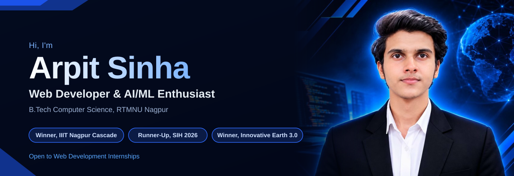

# Hi, I'm Arpit Sinha 👋

I’m a software developer who enjoys turning ideas into clean, reliable, and user-friendly products. I’m especially interested in full-stack development, system design, and building tools that make everyday workflows smoother.

## 🔭 Currently working on
- Building practical projects that combine product thinking with solid engineering
- Improving my skills in backend systems, APIs, and cloud-based architecture
- Exploring modern web and developer tooling

## 🌱 Learning
- JavaScript/TypeScript ecosystems
- Distributed systems and scalable application design
- Cloud and deployment workflows

## 🛠️ Tech Stack
- Languages: JavaScript, TypeScript, Python, C++, Java
- Frontend: React, Next.js, HTML, CSS, Tailwind
- Backend: Node.js, Express, REST APIs
- Tools: Git, GitHub, VS Code, Docker, Postman

## 📈 GitHub Overview

## 🤝 Open to
- Collaboration on interesting projects
- Learning opportunities and technical discussions
- Building useful software with a strong product focus

## 📫 Reach out
- GitHub: [@ArpitSinha11](https://github.com/ArpitSinha11)
- Let’s connect and build something meaningful together.

> “The best way to predict the future is to build it.”
